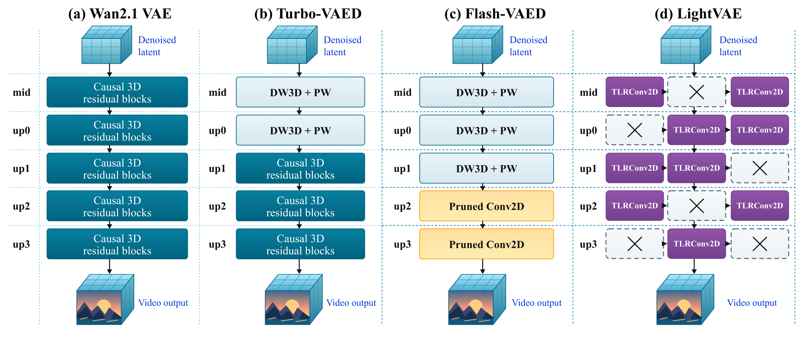
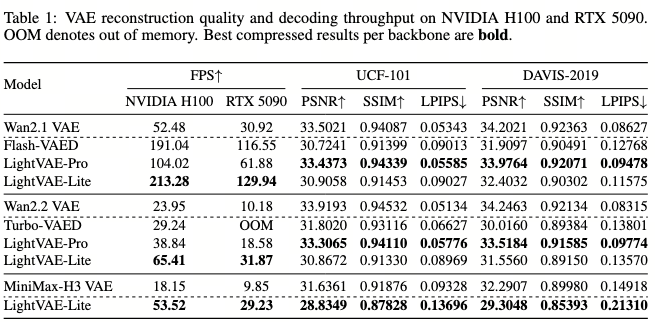

<div align="center">

# ⚡ LightVAE

**Towards Compact and Efficient Video Autoencoders**

Wan2.1 · Wan2.2 · MiniMax-H3

[📄 Paper](https://arxiv.org/abs/2610.14726) · [🤗 Models](https://huggingface.co/lightx2v/LightVAE) · [🧩 ComfyUI](comfyui/README.md) · [⚡ LightX2V](https://github.com/ModelTC/LightX2V)

</div>

## ✨ Overview

**LightVAE** accelerates pretrained video autoencoders while preserving their original latent interfaces.

- **Pro** — temporal low-rank compression with the original decoder depth, available for Wan2.1 and Wan2.2.
- **Lite** — additional block pruning for Wan; independently pruned encoder and decoder for MiniMax-H3.
- **Compatible latents** — compressed components can be paired with their corresponding original components. Wan models retain their original encoders.

This repository provides reconstruction examples, decoder benchmarks and H3 ComfyUI workflows. For video generation with LightVAE, see [LightX2V](https://github.com/ModelTC/LightX2V).



## 📊 Results

Decoder throughput and reconstruction quality reported in **Table 1** of the paper.



## 🎬 Visual Comparisons

**NVIDIA H200 · PyTorch 2.11.0 · CUDA 12.8 · BF16**  
**3 clips × 124 frames · 768p · 24 FPS**

Clips are reconstructed separately, then concatenated. Labels show decoder FPS and PSNR; H3 also reports encoder FPS. Timings use eager execution, one warmup and the median of three runs. PSNR is measured before MP4 compression.

### Wan2.1

Left → right: **Original VAE · LightVAE-Pro · LightVAE-Lite**

<video src="https://github.com/user-attachments/assets/94f0175c-a9bf-4f08-a178-45989785e087" controls width="100%"></video>

### Wan2.2

Left → right: **Original VAE · LightVAE-Pro · LightVAE-Lite**

<video src="https://github.com/user-attachments/assets/5084f558-c200-4764-98cd-8011d95b915f" controls width="100%"></video>

### MiniMax-H3

Left → right: **Original VAE · Lite decoder · Lite encoder + decoder**

<video src="https://github.com/user-attachments/assets/023473e8-8a91-4ffc-91b5-e7e42f0abf4b" controls width="100%"></video>

## 🧩 ComfyUI · MiniMax-H3

The **Load H3 LightVAE** node reuses ComfyUI’s native H3 VAE. No LightVAE package installation, TLR or custom Triton kernels are needed.

- **FL2V:** replace the decoder; keep original first/last-frame encoding.
- **REF2V:** replace the encoder, decoder, or both independently.
- **`none`:** use the corresponding original component. Audio stays unchanged.
- **ConvRot-INT8:** optional quantized Lite decoder; see [download and setup](comfyui/README.md#convrot-int8-decoder).

> Use the [installer](comfyui/README.md#install)—do not clone the entire repository directly into `custom_nodes`. Connect the original H3 video VAE to **`base_vae`**, then select Lite components through **Load H3 LightVAE**, not the standard Load VAE node.

[Installation guide](comfyui/README.md) · [FL2V workflow](comfyui/workflows/h3_fl2v_lightvae.json) · [Image-reference workflow](comfyui/workflows/h3_ref_image_lightvae.json) · [Video-reference workflow](comfyui/workflows/h3_ref_video_lightvae.json)

The current ComfyUI node is **H3-only**. For ComfyUI usage, skip the Python installation below.

## 🛠️ Python Installation

Tested with **Python 3.11** and **PyTorch 2.11.0 / CUDA 12.8**.

```bash
git clone https://github.com/ModelTC/LightVAE.git
cd LightVAE
python -m pip install -r requirements.txt
```

For model-only installation, use `python -m pip install .`; for development, use `python -m pip install -e ".[cli]"`.

```python
from lightvae.wan21_lightvae_decoder import Decoder
from lightvae.h3_lightvae_encoder import Encoder
```

Triton is optional for fused Wan kernels and is usually included with NVIDIA Linux PyTorch. H3 uses PyTorch operations; the ComfyUI node uses ComfyUI’s native H3 backend.

## 🤗 Weights

Download LightVAE checkpoints:

```bash
hf download lightx2v/LightVAE --local-dir weights/LightVAE
```

Use standard, non-INT8 checkpoints with `infer.py` and `benchmark.py`.
`lightvae-lite-h3-decoder-int8-convrot.safetensors` is for the ComfyUI node only.

Download only the original VAE you need for encoding or baseline comparison:

```bash
# Wan2.1
hf download Wan-AI/Wan2.1-T2V-1.3B \
  Wan2.1_VAE.pth --local-dir weights/Wan2.1

# Wan2.2 TI2V-5B
hf download Wan-AI/Wan2.2-TI2V-5B \
  Wan2.2_VAE.pth --local-dir weights/Wan2.2

# MiniMax-H3: config and weight shards
hf download MiniMaxAI/MiniMax-H3 \
  --include "vae/*" --local-dir weights/MiniMax-H3
```

> **Wan2.2 model selection:** 14B models use the **Wan2.1 VAE**; TI2V-5B uses the **Wan2.2 VAE**.

Existing weights can be used directly by passing their paths.

## 🎥 Reconstruction

`infer.py` accepts independent **`--encoder`** and **`--decoder`** checkpoints. Examples use BF16 and produce an **MP4 + JSON report** containing PSNR and timings.

### Wan2.1

```bash
CUDA_VISIBLE_DEVICES=0 python infer.py \
  --model wan21 --variant lite \
  --encoder weights/Wan2.1/Wan2.1_VAE.pth \
  --decoder weights/LightVAE/lightvae-lite-wan21-decoder.safetensors \
  --input demo.mp4 --frames 81 --height 480 --width 832 \
  --output outputs/wan21_lite_recon.mp4
```

### Wan2.2

```bash
CUDA_VISIBLE_DEVICES=0 python infer.py \
  --model wan22 --variant lite \
  --encoder weights/Wan2.2/Wan2.2_VAE.pth \
  --decoder weights/LightVAE/lightvae-lite-wan22-decoder.safetensors \
  --input demo.mp4 --frames 81 --height 704 --width 1280 \
  --output outputs/wan22_lite_recon.mp4
```

For **Pro**, use `--variant pro` and the corresponding `lightvae-pro-…-decoder.safetensors`. Keep the original encoder.

### MiniMax-H3

**Original encoder + Lite decoder**

```bash
CUDA_VISIBLE_DEVICES=0 python infer.py \
  --model h3 --variant lite \
  --encoder weights/MiniMax-H3/vae \
  --decoder weights/LightVAE/lightvae-lite-h3-decoder.safetensors \
  --input demo.mp4 --frames 124 --height 768 --width 1344 \
  --output outputs/h3_lite_recon.mp4
```

**Lite encoder + Lite decoder** — no original VAE weights needed for this Python example.

```bash
CUDA_VISIBLE_DEVICES=0 python infer.py \
  --model h3 --variant lite --encoder-variant lite \
  --encoder weights/LightVAE/lightvae-lite-h3-encoder.safetensors \
  --decoder weights/LightVAE/lightvae-lite-h3-decoder.safetensors \
  --input demo.mp4 --frames 124 --height 768 --width 1344 \
  --output outputs/h3_lite_encdec_recon.mp4
```

**Notes**

- For an original baseline, use `--variant base`, pass the original VAE to both component arguments and leave `--encoder-variant base`.
- `--frames` limits input length. Omit both size arguments to retain the input resolution; specifying both applies resize-to-cover and center cropping.
- PSNR is measured before MP4 compression. Existing output files are not overwritten.

## ⏱️ Decoder Benchmark

Compare original and compressed decoders using identical seeded latent inputs. Each decoder runs in a separate process.

```bash
# Wan2.1
CUDA_VISIBLE_DEVICES=0 python benchmark.py \
  --model wan21 --weights-dir weights/LightVAE \
  --base-weights weights/Wan2.1/Wan2.1_VAE.pth \
  --frames 81 --height 480 --width 832 \
  --warmup 5 --repeats 30 --output outputs/wan21_speed

# Wan2.2
CUDA_VISIBLE_DEVICES=0 python benchmark.py \
  --model wan22 --weights-dir weights/LightVAE \
  --base-weights weights/Wan2.2/Wan2.2_VAE.pth \
  --frames 81 --height 704 --width 1280 \
  --warmup 5 --repeats 30 --output outputs/wan22_speed

# MiniMax-H3
CUDA_VISIBLE_DEVICES=0 python benchmark.py \
  --model h3 --weights-dir weights/LightVAE \
  --base-weights weights/MiniMax-H3/vae \
  --frames 124 --height 768 --width 1344 \
  --warmup 5 --repeats 30 --output outputs/h3_speed
```

Outputs: **`summary.csv`**, **`summary.json`** and per-decoder logs. Use a new output directory for each run.

`--base-weights` specifies the benchmark baseline; it is not an `infer.py` argument.

## 📚 Citation

```bibtex
@misc{gu2026lightvae,
  title={LightVAE: Towards Compact and Efficient Video Autoencoders},
  author={Shiqiao Gu and Yang Yong and Fengjun Zhong and Ruihao Gong and Chengtao Lv and Xiangyu Fan and Lei Yang and Xianglong Liu},
  year={2026},
  eprint={2610.14726},
  archivePrefix={arXiv},
  primaryClass={cs.CV},
  url={https://arxiv.org/abs/2610.14726}
}
```

## ⭐ Support

If you find this useful, please star [LightVAE](https://github.com/ModelTC/LightVAE) and [LightX2V](https://github.com/ModelTC/LightX2V)!
