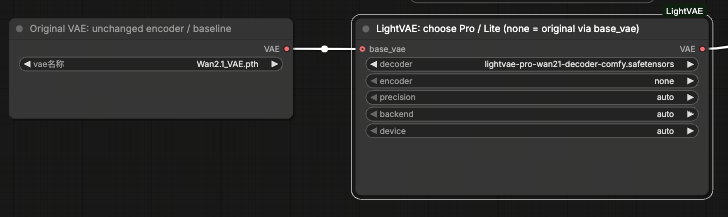
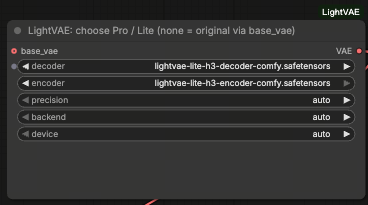

# ⚡ LightVAE for ComfyUI

**Faster video VAEs, with the same workflow.**

Wan2.1 / Wan2.2 **Pro & Lite decoders** · MiniMax-H3 **Lite encoder & decoder**

[Installation](#installation) · [Workflows](workflows/README.md) · [Test results](#test-results) · [GPU support](#gpu-support) · [🤗 Weights](https://huggingface.co/lightx2v/LightVAE)

Connect **Load LightVAE (TLR)** in place of your video VAE. Keep the diffusion model,
sampler and standard ComfyUI `VAE` connections. Wan retains **temporal low-rank (TLR)**
convolutions and fused history kernels; H3 uses its compressed encoder/decoder architecture.

## Installation

From the LightVAE repository, use the **same Python environment as ComfyUI**:

```bash
python -m pip install .
python comfyui/install.py --comfy-root /path/to/ComfyUI
```

Requires Python 3.10+, PyTorch 2.8+ and a ComfyUI version with native support for your
chosen backbone. Install PyTorch through ComfyUI's setup first. Windows portable users
can replace `python` with `python_embeded/python.exe`.

Pip installs the shared **`lightvae`** Python package. The installer then copies only the
ComfyUI adapter, screenshots and workflows to `ComfyUI/custom_nodes/ComfyUI-LightVAE/`.
There is no duplicated model runtime inside the custom node and no ComfyUI core changes.

For local development, use `python -m pip install -e .` instead: changes under `lightvae/`
are picked up after restarting ComfyUI. Run the installer again when changing the node itself.
With a regular installation, rerun `python -m pip install .` after pulling updates.

If loading the node reports `No module named 'lightvae'`, install the package using the
Python executable that actually starts ComfyUI, not a different terminal environment.

Place the **`*-comfy.safetensors`** weights in:

```text
ComfyUI/models/vae/LightVAE/
```

Restart ComfyUI and search for **Load LightVAE (TLR)**. No sidecar JSON is needed.
Once the ComfyUI exports are uploaded to the [model repository](https://huggingface.co/lightx2v/LightVAE), download them with:

```bash
hf download lightx2v/LightVAE --include "*-comfy.safetensors" \
  --local-dir /path/to/ComfyUI/models/vae/LightVAE
```

Use these packed exports, not standalone LightVAE files or third-party dense conversions.
Both the TLR factors and architecture metadata are included in the exports.

## Choose your model

| Generation model | LightVAE decoder | Encoder |
| :-- | :-- | :-- |
| Wan2.1 / Wan2.2 **14B** | `lightvae-{pro,lite}-wan21-decoder-comfy.safetensors` | Original Wan2.1 VAE |
| Wan2.2 **5B TI2V** | `lightvae-{pro,lite}-wan22-decoder-comfy.safetensors` | Original Wan2.2 VAE |
| MiniMax-H3 | `lightvae-lite-h3-decoder-comfy.safetensors` | `lightvae-lite-h3-encoder-comfy.safetensors` or original H3 video VAE |

Wan2.2 **14B uses the Wan2.1 VAE** (16 latent channels); the **5B** model uses the
Wan2.2 VAE (48 channels). Wan encoders and the H3 **audio** VAE remain unchanged.

### Wan · replace the decoder



1. Keep **Load VAE** and connect its output to LightVAE's **`base_vae`**.
2. Select your **Pro / Lite decoder**, leaving **`encoder = none`**.
3. Connect LightVAE's **`VAE`** output to the workflow's encode/decode nodes.

Reference encoding still uses the original encoder; decoding uses LightVAE.
For decode-only workflows, `base_vae` is optional. Set **both selections to `none`**
to use the connected original VAE unchanged, including its precision/device settings.

### H3 · replace encoder and decoder



Select both **H3 Lite** files and connect the `VAE` output to the reference-conditioning
and video-decoding nodes. No original video VAE is needed in this setup.

To replace just one component, set the other to `none` and connect an original **H3 video VAE**
to `base_vae`. Keep the separate audio VAE connected to the audio nodes.

### Ready-to-run generation workflows

Drag a JSON from [**workflows/**](workflows/README.md) into ComfyUI:
**Wan2.1 T2V**, **Wan2.2 5B T2V/I2V**, **Wan2.2 14B I2V**, or **H3 image/video reference**.
The guide lists required model files, reference numbering and sampling defaults.
Only ComfyUI core and this node are required; generated MP4s go to `ComfyUI/output/LightVAE/`.

## Test results

### ComfyUI decoding speed

**NVIDIA H200 · PyTorch 2.11.0+cu128 · Triton 3.6.0 · BF16**  
**768 × 1344**, batch size 1; **125 frames for Wan / 124 frames for H3**.
One warmup, median of three runs, using the same seeded latents within each backbone.

| Backbone | Original VAE | LightVAE-Pro | LightVAE-Lite |
| :-- | --: | --: | --: |
| Wan2.1 | 6.844 s / 18.26 FPS | 3.754 s / 33.30 FPS (**1.82×**) | 2.330 s / 53.64 FPS (**2.94×**) |
| Wan2.2 | 6.886 s / 18.15 FPS | 4.420 s / 28.28 FPS (**1.56×**) | 2.999 s / 41.68 FPS (**2.30×**) |
| MiniMax-H3 | 6.303 s / 19.67 FPS | — | 3.574 s / 34.69 FPS (**1.76×**) |

Timing covers GPU-synchronized **`VAE.decode`**, including output transfer/layout but excluding
model loading and first-use compilation. Wan's 32 latent frames decode to **125** frames;
H3's 37 latent frames decode to **124** frames. Both H3 decoders run in BF16 with their
existing internal tiling; the H3 measurement covers the video decoder only, not encoding or audio.
These are VAE decode speedups, not full-generation speedups or the paper's decoder-only measurements.

### Functional validation

| Check | Result |
| :-- | :-- |
| Wan2.1 T2V | Complete generation and MP4 output verified |
| H3 image-reference generation | Complete video + audio output verified: 1344×768, 362 frames at 24 FPS (~15.08 s) |
| All six LightVAE components | CPU FP32 and H200 BF16 loading / inference verified |
| Standard VAE nodes | Encode, decode and tiled entry points verified; Wan original-encoder fallback is bitwise identical |
| Six generation workflows | Native node schemas and graph validation passed; not all workflows have full-generation tests |

Tested with Python 3.11 and ComfyUI
[`e8665ca`](https://github.com/Comfy-Org/ComfyUI/tree/e8665ca8e4089ab917567cdb491308e1397663d4).
The H3 generation above used a longer clip than the workflow's default 124 frames.

## GPU support

**Not limited to Hopper.** TLR remains factored even without Triton.

| Backend | Execution path | Validation |
| :-- | :-- | :-- |
| NVIDIA BF16 + Triton | Fused normalization and TLR history; portable BF16 kernels for Ampere/Ada | H200 runtime tested; Ampere/Ada compilation checked |
| PyTorch GPU fallback | PyTorch normalization and factored TLR convolutions | H200 tested; other GPU families not hardware-tested |
| CPU | PyTorch FP32 | Functional tests passed; intended for debugging |

H3 uses PyTorch convolutions and attention, not the Wan Triton kernels. Other GPU backends
need working Conv2d/Conv3d and SDPA support in their PyTorch build; compatibility and speed
on untested hardware are not guaranteed.

- **`backend = auto`** uses supported Triton kernels on NVIDIA BF16, otherwise PyTorch.
  Select **`torch`** for installations without a working Triton compiler; TLR remains enabled.
- **`precision = auto`** uses ComfyUI's BF16/FP32 choice; CPU uses FP32. Explicit BF16/FP16/FP32
  is also available. FP32 costs more memory; FP16 has a smaller numerical range.
- **`device = auto`** follows ComfyUI's VAE loading/offloading settings; `cpu` is available.

## Notes

- Use standard **`VAE`** nodes. Custom sockets such as **`WANVAE`** are not drop-in compatible.
  Wan's native ComfyUI boundary uses raw latents; H3 uses normalized latents. Do not rescale manually.
- ComfyUI manages model offload, but selected components load as a whole. H3 encoder + decoder
  are resident together. LightVAE does not reduce the diffusion model or text encoder's memory needs.
- Wan supports **VAE Decode (Tiled)**; H3 retains its own spatial/temporal stitching.
- H3 may emit an RMSNorm FP32-input/BF16-weight warning: PyTorch uses its non-fused path.
  This warning alone is not a failed decode.

Model definitions, TLR/Triton kernels and bundled model configs live in the installed **`lightvae`**
package. The custom node imports `lightvae.*`; it contains only the adapter, **`assets/`**
and **`workflows/`**. Weights, test outputs, benchmark scripts and export/build tools are
local development files and are not installed with the node.
